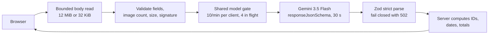
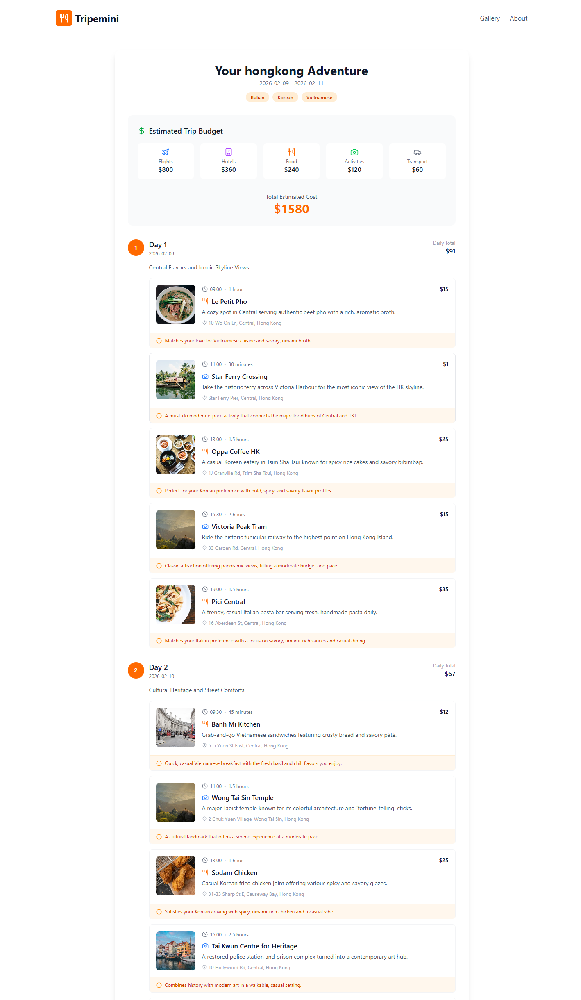

# Design notes

Tripemini is small, so the hard parts are not the UI or the data model.
They are at the model boundary: a public, unauthenticated endpoint takes untrusted images and text, spends money on a model call, and gets back text that only looks like structured data.
This document explains how each side of that boundary is handled, what the hackathon build got wrong, and what is still out of scope.

## Request path

Everything before the gate is cheap and runs on every request; everything after it costs a model call, so a request reaches the gate only once it is known to be well formed.

## Decisions

### Bound the body while reading it

`Content-Length` is checked first, but a client can omit or understate it.
`readBoundedRequestBody` counts bytes as the stream arrives and cancels the read past 12 MiB for uploads or 32 KiB for itinerary JSON, so the server never buffers more than the limit.
Two tests send undeclared oversized bodies and expect `413`.

### Check image bytes, not only the declared type

The browser's declared MIME type is a claim from the client.
The upload route compares the first bytes of each file with the JPEG, PNG, or WebP signature for its declared type and rejects a mismatch before the image is encoded for the model.

### Validate model output twice

Gemini is called with `responseMimeType: "application/json"` and a JSON Schema generated from the same Zod schema the server uses to parse the answer.
The schema sent to Gemini drops `minLength`, `maxLength`, and `pattern`, which the code treats as unsupported there, and a test pins the keyword set; the Zod schema still enforces those limits on the way back.
Every object is `.strict()`, so an extra key such as an image URL fails validation instead of passing through.
Malformed JSON or a schema miss becomes a `502` with a generic message; nothing partial reaches the page.

### Let the server own the facts it can compute

The model returns days, items, costs, and a budget breakdown, and nothing else.
The server derives the itinerary ID from a SHA-256 of the validated inputs and the parsed answer, the item IDs, the dates from the validated start date, the day numbers, each daily total, and the budget total.
A draft with a different number of days than the user asked for is rejected rather than trimmed or padded.

### Keep user text as data

Validated trip fields are serialized as JSON between `UNTRUSTED_USER_DATA` markers, and the system instruction says to treat that block as inert.
This lowers prompt-injection risk but does not remove it; the real limit on the damage is the output schema, which allows only bounded strings and numbers and no URLs.

### One gate for both routes

Both routes share one in-process gate: ten model calls per client per minute, four in flight per process, and at most 10,000 tracked clients, each refusal a `429` with `Retry-After`.
The per-client count only increases when a call is admitted, so a client refused for concurrency does not also lose quota.
Gemini's own quota is separate.
The key is on the free tier, and its `429` on 2026-11-08 named a limit of 20 requests per model per day, yet the live demo kept answering after local calls with the same key were refused, so how that limit is counted is not known.
A Gemini `429` becomes a `503` whose message says the daily quota resets at midnight Pacific time, so a visitor sees why the demo stopped instead of "Failed to generate itinerary".

### A deadline must not free the slot early

The route answers `504` after 30 seconds, but the abandoned provider call may still be running and billing.
If the deadline released the concurrency slot, slow calls could pile up past the four-call cap while each user saw a timeout.
So the slot is released only when the provider promise settles, and the test `timed-out work keeps its concurrency slot until the provider settles` holds a call open past its deadline and checks that the next caller gets `429` until it finishes.

## Failures found and fixed

The hackathon build (commit `b40f99d`, January 25, 2026) worked in a demo and failed at the boundary.
The July hardening in [#1](https://github.com/hskl18/Tripemini/pull/1) and [#2](https://github.com/hskl18/Tripemini/pull/2) fixed the cases below.

### Model-chosen image URLs showed the wrong places

The hackathon prompt asked the model to "Use real Unsplash photo URLs relevant to" the destination (`src/app/api/generate-itinerary/route.ts`, line 76 at `b40f99d`), and the page rendered whatever URL came back.
The submission screenshot below shows the result for a three-day Hong Kong trip: Victoria Peak Tram and Wong Tai Sin Temple share one photo of a misty mountain range, and the Star Ferry crossing is illustrated with a palm-lined river.

The fix removed images from the model contract entirely.
The prompt now forbids URLs, the strict schema rejects any extra key, and the Content Security Policy allows images only from the app's own origin and inline data; the test `itinerary output is canonicalized and excludes model-controlled URLs` covers it.

### Model text was parsed as trusted JSON

Both hackathon routes stripped Markdown fences from the reply and called `JSON.parse` on what was left, with no schema check (lines 82 to 86 of the itinerary route at `b40f99d`).
The same prompt asked the model to "Calculate dailyTotal and budgetBreakdown.total correctly", so arithmetic shown to the user came from the model.
Any malformed reply became a generic `500`, and any well-formed wrong reply went straight to the page.
The fix is the schema-and-parse design above, and the test `model routes reject malformed or out-of-contract output` covers it.

### User text was spliced into instructions

The hackathon prompt began `` Create a ${preferences.tripLength}-day travel itinerary for ${preferences.destination}. `` (line 28 at `b40f99d`), so whatever the user typed as a destination became part of the instructions.
The fix is the untrusted-data block, and the test `itinerary prompt treats user fields as untrusted JSON data` checks that user text appears only inside it.

### Uploads had no server-side limits

The upload hint said "PNG, JPG up to 10MB", but the server read the whole multipart body, accepted any number of files, and passed each file's declared MIME type to the model unchecked.
The fix is the bounded read, the count and size limits, and the signature check above, with six tests on the upload route.

### The UI promised features that did not exist

The hackathon result page had a "Share Itinerary" button with no click handler, and the header linked to Gallery and About pages.
[#1](https://github.com/hskl18/Tripemini/pull/1) removed them, and [#2](https://github.com/hskl18/Tripemini/pull/2) added an "Illustrative, unverified draft" warning above the itinerary and rewrote the README, proposal, and metadata to match the shipped code.

### A lint dependency advisory Dependabot could not fix

In November 2026, Dependabot raised an alert for `minimatch` 10.2.6 (GHSA-g3hv-75wg-m249), pulled in by `@typescript-eslint/typescript-estree`, and its automatic security update failed with `security_update_not_possible`, because the first fixed version, 11.0.1, is outside the `^10.2.2` range that package declares.
typescript-estree only calls the CommonJS `minimatch()` export, which 11.x keeps, so [#8](https://github.com/hskl18/Tripemini/pull/8) forces that copy to 11.0.5 with a pnpm override and removes the audit exception that had covered it.

### The itinerary step failed on every request

On 2026-11-08 a full run in a headless browser failed at step 2, both locally and on the live demo, while the food step still worked.
The 21 tests never call Gemini, so neither cause showed up in CI.

- Gemini rejected the itinerary schema with `400 INVALID_ARGUMENT` whenever both nested arrays, the days and the items of each day, declared `maxItems`; removing either bound was enough.
  The schema sent to Gemini no longer bounds the days, and the route still requires exactly the requested 1 to 14 days.
- With the schema accepted, the model wrote times such as `09:00 AM`, and the `HH:MM` regex turned every itinerary into a `502`, because the regex is one of the keywords stripped from the schema Gemini sees.
  The `time` field now carries a description of the format, which Gemini does see.

After the fix, two of two live three-day runs returned schema-valid itineraries with 24-hour times, and the test `the itinerary schema sent to Gemini avoids nested maxItems and states the time format` pins both changes.

## Not solved here

- The gate is per process; on serverless hosting each instance has its own counters, so a determined client can exceed the nominal limits.
  A public deployment that matters needs a platform rate limit and a spend alert.
- The routes log each model call's duration but nothing collects those logs, so there are no measured latency, token, or cost figures.
- Nothing measures whether the inferred taste profile is accurate or whether generated places exist; the UI says so instead.
- No test calls Gemini, so a provider-side schema rule or a change in the model's output format shows up only in a live run.
