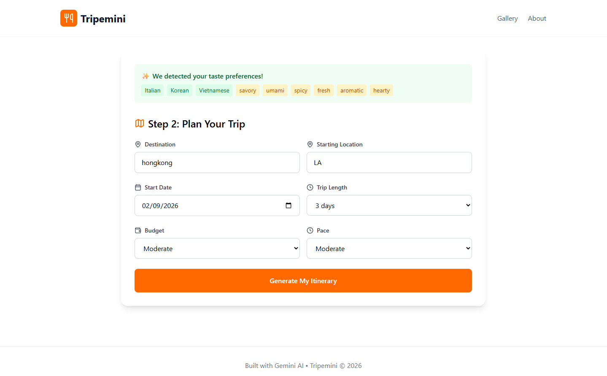

# Tripemini

[](https://github.com/hskl18/Tripemini/actions/workflows/ci.yml)

Tripemini turns food photos into a taste profile, then turns that profile into a multi-day travel itinerary draft.
It uses Gemini multimodal inference with schema-constrained JSON output, validated again on the server before anything reaches the page.
Most planners start from a destination or a budget; Tripemini tests whether a few photos of dishes you love are a quicker way to say what you want from a trip.

**Status: hackathon MVP, maintained for security (v0.2.0).**
I built it for the [Gemini 3 Hackathon](https://gemini3.devpost.com/) in January 2026, hardened its model boundaries in July 2026, and now only ship dependency and security updates.

**Live demo: [tripemini.vercel.app](https://tripemini.vercel.app).**
It needs no sign-up and calls Gemini on the server, so each client is limited to ten model calls a minute.



*Recorded for the hackathon submission in January 2026, before the July hardening; the current page no longer has the Gallery and About links.*

Run it locally with Node.js 22 or newer and pnpm 10:

```bash
pnpm install --frozen-lockfile && pnpm dev
```

The page and all input validation work without a key, but both model calls return `500` until you copy `.env.example` to `.env.local` and set `GOOGLE_GEMINI_API_KEY`.
`pnpm test` runs 21 deterministic tests with no key and no network.

## Non-goals

- It is not a booking engine, map, or route optimizer.
- It has no live place, price, or availability data, so every place, address, price, and schedule in a draft is generated and unverified.
- It has no accounts, saved itineraries, or sharing.
- Its rate and concurrency limits are per server process, not durable across instances, so they are safeguards rather than an abuse or spend control.

## How it works

1. Upload one to four food photos; `POST /api/analyze-food` returns a taste profile of cuisines, flavors, dining styles, ingredients, and a confidence score.
2. Enter a destination, starting location, date, trip length, pace, and budget style; `POST /api/generate-itinerary` returns a day-by-day draft with meals, attractions, reasons, and illustrative costs.
3. The result page labels the draft as illustrative and unverified before it shows any generated place.

The hard parts are at the model boundary: untrusted input in, untrusted model output out, on a public endpoint that costs money per call.
[DESIGN.md](DESIGN.md) explains the decisions and the failures in the hackathon build that the July hardening fixed.

## Request boundaries

- Food analysis accepts one to four JPEG, PNG, or WebP images.
- Each image is limited to 4 MiB, and the complete multipart request is limited to 12 MiB.
- Itinerary requests are limited to 32 KiB and trips from 1 to 14 days.
- Destination, location, date, preference arrays, enums, and confidence values are validated before model execution.
- Declared image MIME types are checked against JPEG, PNG, or WebP file signatures before upload content reaches the model.
- Gemini responses use JSON schemas and are validated again at runtime before the application returns them.
- User-provided trip fields are serialized inside an explicit untrusted-data boundary in the itinerary prompt.
- Model calls have a 30-second deadline and invalid model responses fail closed.
- IDs, dates, item totals, and the total budget are computed by the server instead of trusted from model output.
- One process permits at most four concurrent model calls.
- One client may start at most ten model calls per minute.
- Rate-limit state tracks at most 10,000 clients per process.
- Limit responses use `429` and include `Retry-After`.

A multi-instance public deployment also needs durable platform-level rate limiting, spend alerts, and abuse monitoring.

## Image handling and privacy

Uploaded images are sent to the server-side model integration for analysis.
The application does not intentionally persist uploaded images or generated itineraries, but the configured model provider processes request content under its own terms.
Do not upload sensitive photos or images containing private personal information.

## Verification

```bash
pnpm audit --audit-level low
pnpm test
pnpm lint
pnpm typecheck
pnpm build
```

CI runs the same five steps on every push to `main` and every pull request.
The deterministic suite does not call Gemini.
It covers streamed and declared payload limits, image count, size and signature rules, trip input validation, prompt-data isolation, structured model output, canonical server fields, timeouts, rate limiting, bounded client tracking, and model concurrency.

## Architecture

| Path | Responsibility |
| --- | --- |
| `src/app/api/analyze-food` | Validates bounded multipart uploads and requests a structured taste-profile draft. |
| `src/app/api/generate-itinerary` | Validates trip inputs, requests a structured itinerary draft, and computes the canonical fields. |
| `src/lib/api-guards.ts` | Implements request-size, validation, rate, concurrency, deadline, and client-tracking boundaries. |
| `src/lib/model-contracts.ts` | Defines model-output schemas and fail-closed runtime parsing. |
| `src/lib/gemini.ts` | Configures the server-side Gemini 3.5 Flash client and structured output. |
| `src/store/trip-store.ts` | Holds temporary browser-side workflow state. |

[PROPOSAL.md](PROPOSAL.md) records the hackathon concept against what shipped, and [MARKET.md](MARKET.md) lists the product hypotheses that remain unvalidated.

## History

- January 2026: the hackathon MVP, from the first commit on January 15 to the UI pass on January 25.
- July 2026: request boundaries ([#1](https://github.com/hskl18/Tripemini/pull/1)), then schema-validated model output, untrusted-data prompts, and claims aligned with the shipped code ([#2](https://github.com/hskl18/Tripemini/pull/2)).
- September to November 2026: dependency security updates and Vercel Speed Insights.

## Security

See [SECURITY.md](SECURITY.md) to report a vulnerability.

## License

This project is available under the [MIT License](LICENSE).
